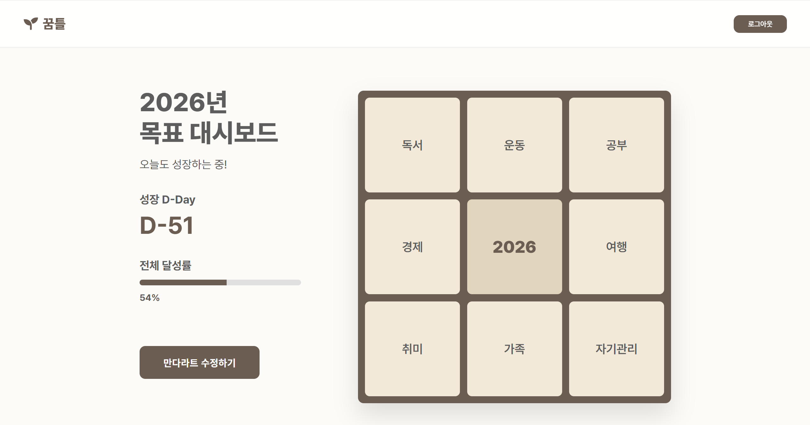
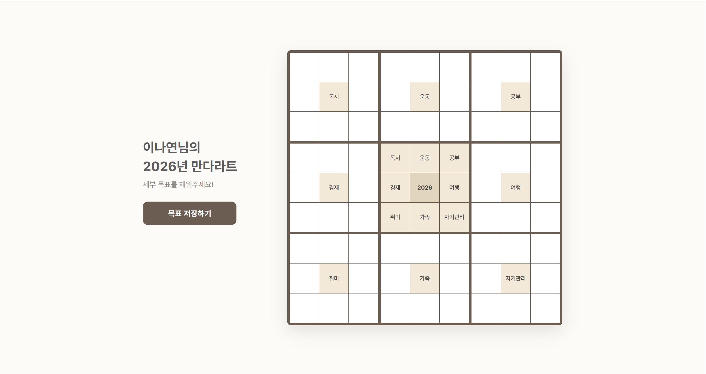
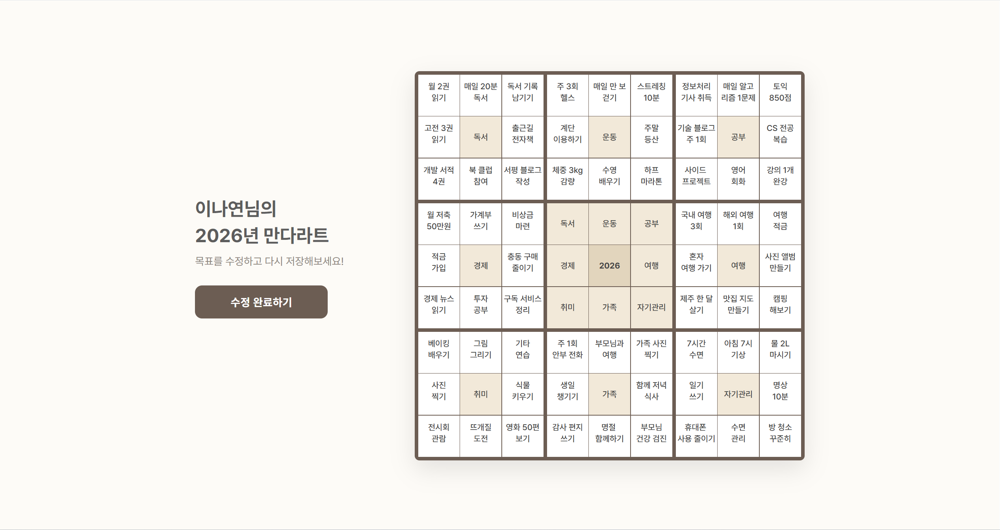
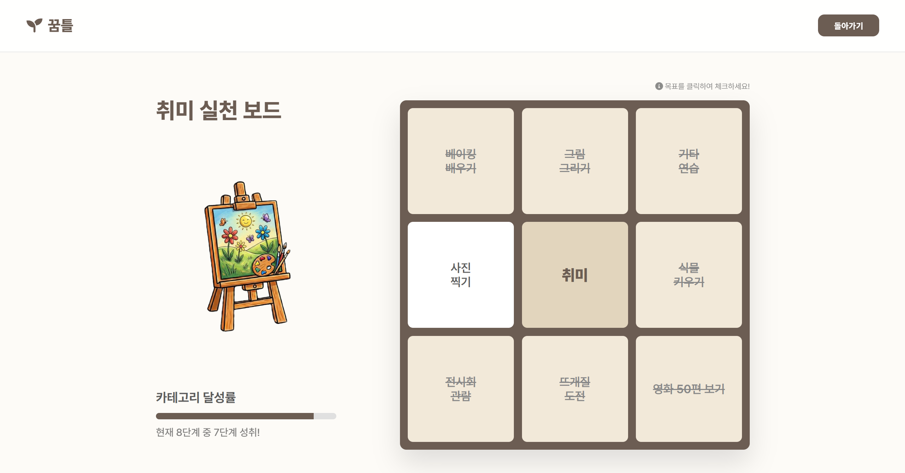
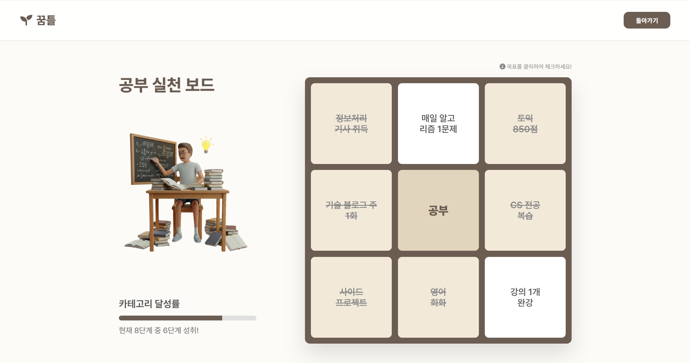

# 꿈틀 (IDEAL-Kkumteul)

'꿈을 담는 틀'이라는 뜻의 만다라트 목표 관리 웹 서비스입니다.
사용자는 Google 계정으로 로그인해 9x9 만다라트 계획표를 작성하고,
세부 목표를 하나씩 달성할 때마다 영역별 이미지가 자라나는 것을 보며 진행 상황을 확인할 수 있습니다.

Spring Boot와 Spring Data JPA로 구현한 팀 프로젝트입니다.

## 개요

| 항목 | 내용 |
| --- | --- |
| 기간 | 2026.02 ~ 2026.03 (약 1달) |
| 인원 | 3명 (이세연, 이나연, 조혜인) |
| 담당 | 기여도 약 35%<br>- 엔티티 및 DB 설계 (User, Mandalart, Category, Cell)<br>- 만다라트 작성/수정 (81칸 입력값 저장, 수정 시 기존 값 불러오기)<br>- 메인 화면 (전체 달성률, D-Day, 최근 달성 목표) |

## 기술 스택

| 분류 | 기술 |
| --- | --- |
| Language | Java 21 |
| Framework | Spring Boot 3.4, Spring Data JPA, Spring Security, OAuth2 Client |
| Database | MySQL 8 |
| View | Thymeleaf, HTML, CSS, JavaScript |
| Build | Gradle |
| Tool | IntelliJ IDEA, Git, GitHub |

## 주요 기능

- Google 로그인: 첫 로그인 시 회원 정보 저장, 이후 로그인 시 이름 갱신
- 만다라트 작성: 중심 목표와 8개 영역(독서, 운동, 공부, 경제, 여행, 취미, 가족, 자기관리)의 세부 목표 64개 입력
- 만다라트 수정: 저장된 목표를 원래 위치에 불러와 수정
- 메인 화면: 전체 달성률, 연말까지 남은 D-Day, 최근 달성한 목표 표시
- 영역 상세: 세부 목표 완료 체크, 달성 개수에 따라 8단계로 자라는 영역별 이미지와 진행률 표시

## 프로젝트 구조

```
src/main/java/com/kkumteul
├── config        Spring Security, OAuth2 로그인 설정
├── controller    화면 컨트롤러, 완료 체크 REST API
├── domain        JPA 엔티티 (User, Mandalart, Category, Cell)
├── repository    Spring Data JPA 리포지토리
└── service       만다라트 저장/수정/조회, OAuth2 사용자 처리
src/main/resources
├── templates     Thymeleaf 화면 (랜딩, 작성/수정, 메인, 영역 상세)
└── static        CSS, JavaScript, 영역별 단계 이미지
database          테이블 생성 SQL
```

## 데이터베이스

```
users 1 ── N mandalarts 1 ── N categorys 1 ── N cells
```

| 테이블 | 설명 |
| --- | --- |
| users | Google 계정 정보 (google_id, email, name) |
| mandalarts | 사용자별 만다라트 (중심 목표) |
| categorys | 만다라트의 8개 영역 (9x9 그리드 안의 블록 위치, 영역 이름) |
| cells | 영역별 세부 목표 (블록 안의 칸 위치, 내용, 완료 여부) |

## 담당 업무

### 1. 엔티티 및 DB 설계

만다라트의 9x9 그리드를 `만다라트 > 영역(블록) > 세부 목표(칸)` 계층으로 나누어 엔티티를 설계했습니다.

- 각 영역과 세부 목표에 그리드상의 위치(`position`, `cell_index`, 0-8)를 저장해, 화면의 칸과 DB 데이터를 위치 값으로 매칭
- 연관관계는 모두 지연 로딩(`FetchType.LAZY`)으로 설정하고, `cascade = ALL`과 `orphanRemoval`을 적용해 만다라트 하나만 저장하면 하위 영역과 세부 목표가 함께 저장되도록 구성
- 생성자에서 부모 엔티티의 컬렉션에 자신을 추가해 양방향 연관관계가 항상 함께 설정되도록 처리
- 엔티티의 기본 생성자는 `protected`로 제한하고, 값 변경은 `updateContent()`, `toggleCompletion()` 같은 메서드로만 가능하도록 설계

### 2. 만다라트 작성/수정

- 작성: 81칸의 입력값을 `goal[i][j]` 형식의 이름으로 한 번에 받아(`Map<String, String>`) 영역과 세부 목표 엔티티로 변환 후 저장
- 수정: 저장된 데이터를 `goal[position][index]` 키의 Map으로 변환해 폼의 원래 칸에 다시 채우고, 변경된 내용은 JPA 변경 감지(Dirty Checking)로 별도 `save` 호출 없이 반영
- 서비스 클래스에 `@Transactional(readOnly = true)`를 기본으로 두고, 쓰기 메서드에만 `@Transactional`을 적용

### 3. 메인 화면

- 모든 영역의 세부 목표를 Stream으로 펼쳐 전체 달성률 계산 (목표가 없을 때 0으로 나누지 않도록 처리)
- 완료된 목표 중 최근 3개를 추려 최근 활동으로 표시
- 연말까지 남은 일수를 계산해 D-Day 표시
- 로그인 후 만다라트가 없으면 작성 화면으로, 있으면 메인 화면으로 이동하도록 분기


## 화면
| 메인 |
| --- |
|  |

| 랜딩 | 만다라트 작성 |
| --- | --- |
|  |  |

| 영역 상세 1 | 영역 상세 2 |
| --- | --- |
|  |  |


## 트러블슈팅

### 1. 수정 화면에서 기존 목표가 다른 칸에 표시되는 문제

- 문제: 만다라트 수정 화면에 진입하면 일부 영역의 세부 목표가 엉뚱한 블록에 채워졌습니다.
- 원인: 9개 블록 중 가운데 블록(4번)은 중심 목표 영역이라 별도 영역으로 저장하지 않기 때문에, 영역 목록은 8개입니다. 이 목록의 반복 순번을 블록 번호로 사용하자 4번 이후 영역이 한 칸씩 앞 블록에 매칭되었습니다.
- 해결: 반복 순번 대신 엔티티에 저장한 블록 위치(`position`)를 키로 사용하도록 변경해, 화면의 블록 번호와 DB 데이터가 항상 일치하도록 했습니다.

### 2. 저장할 때마다 만다라트가 새로 생성되는 문제

- 문제: 수정 화면에서 저장하거나, 뒤로 가기로 작성 화면에 다시 들어가 저장하면 기존 만다라트가 수정되지 않고 새 만다라트가 계속 추가되었습니다. 홈 화면은 첫 번째 만다라트로만 이동하기 때문에, 사용자에게는 저장한 내용이 사라진 것처럼 보였습니다.
- 원인: 저장 API는 요청에 `mandalartId`가 있으면 수정, 없으면 신규 생성으로 처리하는데, 수정 화면 컨트롤러가 이 값을 화면에 전달하지 않았습니다. 또한 작성 화면은 이미 만다라트가 있는 사용자도 제한 없이 접근할 수 있었습니다.
- 해결: 수정 화면에 `mandalartId`를 전달해 수정 요청이 기존 데이터에 반영되도록 하고, 이미 만다라트가 있는 사용자가 작성 화면에 접근하면 메인 화면으로 이동시켜 중복 생성을 막았습니다.

### 3. 수정 시 처음 비워 둔 칸이 저장되지 않는 문제

- 문제: 처음 작성할 때 비워 둔 칸을 수정 화면에서 새로 채워도 저장되지 않았습니다.
- 원인: 작성 시에는 내용이 있는 칸만 세부 목표 엔티티로 저장하는데, 수정 로직은 DB에 이미 있는 세부 목표만 순회하며 내용을 변경했습니다. 그래서 처음 비어 있던 칸은 수정할 대상 자체가 없었습니다.
- 해결: 수정 시 블록의 8칸을 모두 순회하며, 기존 세부 목표가 있으면 내용을 변경하고 없으면 새로 생성하도록 변경했습니다. 새로 만든 엔티티는 영속성 전이(`cascade`)로 별도 `save` 호출 없이 함께 저장되도록 했습니다.

## 실행 방법

1. MySQL에 `kkumteuldb` 데이터베이스 생성 (테이블은 실행 시 JPA가 자동 생성, 구조는 `database` 폴더 참고)
2. Google Cloud Console에서 OAuth 클라이언트 ID 발급
3. `src/main/resources/application.properties` 작성 (보안을 위해 레포에는 포함하지 않음)

```properties
spring.datasource.url=jdbc:mysql://localhost:3306/kkumteuldb
spring.datasource.username=
spring.datasource.password=
spring.jpa.hibernate.ddl-auto=update
spring.security.oauth2.client.registration.google.client-id=
spring.security.oauth2.client.registration.google.client-secret=
spring.security.oauth2.client.registration.google.scope=profile,email
```

4. 실행

```bash
./gradlew bootRun
```

## 회고

- 9x9 그리드를 계층형 엔티티로 나누고 위치 값으로 화면과 연결하면서, 화면 구조를 데이터 구조로 옮기는 설계를 고민해 볼 수 있었습니다.
- JPA의 연관관계, 영속성 전이, 변경 감지를 직접 적용하며 SQL을 직접 작성하던 방식과 비교해 객체 중심으로 데이터를 다루는 방법을 익혔습니다.
- 직접 서비스를 실행해 보며 중복 생성, 빈 칸 미저장 문제를 발견하고 수정했습니다. 기능을 구현하는 것만큼 실제 사용 흐름(뒤로 가기, 재수정 등)으로 검증하는 과정이 중요하다는 것을 느꼈습니다.
- 아쉬운 점은 D-Day 기준일을 코드에 고정한 것입니다. 사용자가 목표 기간을 직접 정할 수 있도록 개선하려고 합니다.
